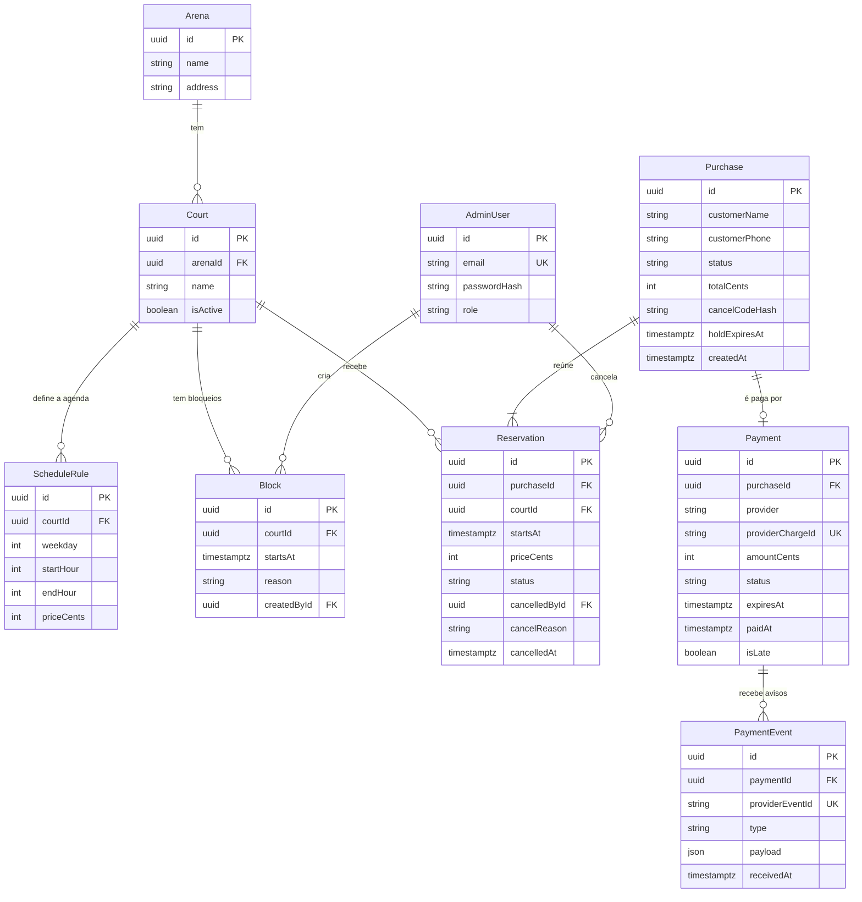

# 🛠️ Architecture / Software Design Document

**Projeto:** Reserva de Horários em Quadras de Areia
**Versão:** 1.1.0
**Última atualização:** 2026-10-12

> 🤖 **O `prd.md` responde _o quê_ o produto faz. Este responde _onde as coisas
> moram e como se chamam_.** Detalhe de tela — rota, componente, contrato —
> **não** se decide aqui: isso é trabalho da spec de cada história.
>
> ✍️ **Não preencha na mão:** rode `/utf-architecture` (depois do `/utf-prd` e do `/utf-flows`).
> A entrevista decide com você cada seção e garante as quatro declarações que o
> `/utf-setup` exige: **framework do backend, framework do frontend, estrutura
> do monorepo e como rodar os testes.**

---

## 🤖 1. Fontes de Contexto para a IA

> Onde a IDE agêntica busca a verdade. **Isto é o índice; a configuração mora
> nos arquivos** — documento não configura ferramenta.

| Fonte | Onde configurar | Serve para |
| :---- | :-------------- | :--------- |
| Constituição da IA | `.agents/rules/utf-rules.md` (via `CLAUDE.md`) | Regras inegociáveis: fases do SDD, 2 rodadas, revisores distintos, Git |
| Fluxos da IA | `.agents/workflows/` | PRD, backlog, jornadas e tokens, architecture, setup, ciclo por Issue, ciclo por tarefa, tutor |
| Agentes (subagentes) | `.agents/agents/` (cascas em `.claude/`, `.cursor/` e `.opencode/`) | Implementador, revisores, auditor final e tutor |
| Ficha da disciplina | `docs/checklist.md` | Regras do projeto, IDs e entregas |
| Design (Figma/Stitch) | <https://deer-quilt-67996631.figma.site/> (tokens em `docs/design-tokens.md`) | Cores, tipografia, hierarquia visual |

---

## 📦 2. Stack Tecnológica

> Definição **estrita**: nenhuma dependência entra sem aparecer aqui. Esta
> seção e o `package.json` contam a mesma história, ou o projeto já se perdeu.
> O que a ficha da disciplina fixa entra como está; o que ela deixa livre é
> decidido na entrevista.

Versões registradas pela **linha major** (conferidas na documentação oficial via
Context7 em 2026-10-12); o pin exato vive no `package.json` de cada app.
Ambiente de desenvolvimento: **Node.js 22.18+** (o mínimo comum a NestJS 12,
Prisma 7 e `create-vue`) e **Docker** para o banco local.

- **Backend:** **NestJS 12+** em módulos **ESM**, com **Prisma ORM 7+** (gerador
  `prisma-client`, configuração em `prisma.config.ts`, driver adapter
  `@prisma/adapter-pg`) sobre **PostgreSQL 18** — a mesma major no Docker local, no
  CI e no Neon. O Prisma 8 ficou de fora por ainda ser *release candidate*, sem
  níveis de isolamento de transação nem os códigos de erro no estilo `P2002`, de que
  a regra de exclusividade depende. Pacotes do ecossistema Nest, na versão
  compatível com a major 12: `@nestjs/config`, `@nestjs/jwt`, `@nestjs/swagger`,
  `@nestjs/schedule`, `@nestjs/throttler`; validação com `class-validator` +
  `class-transformer`; hash de senha com `argon2`.
- **Pagamento:** **AbacatePay** (Pix, checkout transparente), em **devMode**: a
  cobrança Pix existe de verdade e o pagamento é simulado sob demanda pelo endpoint
  de simulação, sem dinheiro real (RN20). ⚠️ O ID20 cita "Mercado Pago ou Stripe" —
  a escolha da AbacatePay depende do **aceite do professor**. Ela mora atrás da
  fronteira única `PaymentGateway` (§2.1), então trocar de provedor é escrever outro
  adapter, não mexer em regra.
- **Frontend:** **Vue 3+** com **Vite**, **TypeScript** e **Vue Router**, gerado
  pelo `create-vue`.
- **Padrões de código do frontend (Vue):**
  - Composition API com `<script setup lang="ts">` — sem Options API.
  - Estado local com `ref` e `computed`; estado que atravessa telas (o token do
    administrador) em um composable dedicado, sem biblioteca de estado global.
  - Roteamento com **lazy loading por rota** (`component: () => import(...)`).
  - Props e emits **tipados** com `defineProps<...>()` e `defineEmits<...>()`.
- **Estilo:** **Tailwind CSS 4+** via plugin `@tailwindcss/vite`. Os tokens de
  `docs/design-tokens.md` são declarados no `@theme` com o **mesmo nome semântico**
  (`--color-primaria`, `--color-perigo`...), gerando utilitários como
  `bg-primaria` e `text-perigo`. Cor, espaçamento ou fonte fora dos tokens não
  entram em componente.
- **Contrato da API no frontend:** `openapi-typescript` (dependência de
  desenvolvimento) gera os tipos a partir do Swagger vivo (§2.2); o cliente HTTP é
  o `fetch` nativo, tipado por esses tipos.
- **Testes e lint:**

  | App | Suíte | Ferramentas | Comandos exatos (dentro da pasta do app) |
  | :-- | :---- | :---------- | :--------------------------------------- |
  | `apps/api` | Unitários (`src/**/*.spec.ts`, ao lado do código) | Vitest | `npm test` |
  | `apps/api` | E2E (`test/**/*.e2e-spec.ts`), HTTP real contra o PostgreSQL do Docker | Vitest + Supertest | `npm run test:e2e` |
  | `apps/api` | Cobertura | Vitest | `npm run test:cov` |
  | `apps/api` | Lint | oxlint (padrão do gerador do Nest 12) | `npm run lint` |
  | `apps/web` | Unitários e de componente (`src/**/*.spec.ts`) | Vitest + `@vue/test-utils` | `npm run test:unit` |
  | `apps/web` | E2E de navegador (`e2e/**/*.spec.ts`) | Playwright | `npm run test:e2e` |
  | `apps/web` | Lint | ESLint (+ Prettier para formato) | `npm run lint` |

  No CI (ID18), cada app roda `npm ci`, `npm run lint` e as suítes acima; a API sobe
  um PostgreSQL 18 como *service container* do GitHub Actions, e o web instala os
  navegadores do Playwright antes do E2E. Nenhuma suíte depende de rede externa ou
  de chave do gateway: sem credencial, entra o provedor local (§2.1).

### 🧱 2.1. Backend — regras estruturais

> Declaradas uma a uma na entrevista, percorrendo os IDs da ficha (camadas,
> validação de entrada, autenticação, formato de resposta e erro, segredos,
> integrações). **É esta declaração que os revisores usam como critério fixo.**

1. **Camadas (ID6).** Cada domínio é um **módulo Nest** com `*.module.ts`,
   `*.controller.ts`, `*.service.ts` e a pasta `dto/`.
   - **Controller** só recebe a requisição, valida via DTO e delega: nenhuma regra
     de negócio nem chamada ao Prisma.
   - **Service** contém a regra de negócio e é o único que acessa o banco, pelo
     `PrismaService`.
   - Um módulo só usa outro pelo **service que este exporta** — nunca importa
     controller nem acessa as tabelas do outro domínio direto.
   - `PrismaService` vive em um módulo global (`src/prisma/`) e é o único lugar que
     instancia o `PrismaClient`.
2. **Validação de entrada (ID7).** Toda entrada (body, query, params) chega por um
   **DTO** com decorators do `class-validator`. `ValidationPipe` **global** em
   `main.ts` com `whitelist: true`, `forbidNonWhitelisted: true` e
   `transform: true`: campo não declarado é recusado com 400. Erro de validação
   responde no formato de erro do item 5, com o campo que falhou.
3. **Persistência (ID8).** Prisma 7 com o schema em `apps/api/prisma/schema.prisma`
   e migrations versionadas em `apps/api/prisma/migrations/` (`prisma migrate dev`
   local; `prisma migrate deploy` em CI e produção). A arena única (RN21) e o
   primeiro administrador nascem no **seed**. Operação que muda mais de uma tabela
   (criar compra com reservas, confirmar pagamento) roda em
   `prisma.$transaction`.
4. **Exclusividade do horário (RN01, NFR de concorrência).** A garantia é do
   **banco**: índice **único parcial** em `Reservation (courtId, startsAt)`
   restrito aos status `HELD`, `PENDING` e `CONFIRMED`, declarado no schema com o
   preview `partialIndexes` (Prisma 7.4+). A segunda tentativa recebe `P2002`, que
   o service traduz em **409 Conflict** ("horário ocupado"). Checagem prévia na
   aplicação é cortesia de UX, nunca a garantia.
5. **Formato de resposta e de erro (ID10).**
   - **Interceptor global** de resposta envelopa todo sucesso em `{ "data": ... }`.
   - **Exception Filter global** transforma toda exceção no formato único
     `{ "statusCode", "error", "message", "fields"?, "path", "timestamp" }` —
     `fields` só em erro de validação, apontando o campo. Erro inesperado responde
     500 com mensagem genérica e o detalhe vai só para o log, nunca para o cliente.
   - Recusas de negócio usam exceções do Nest (`ConflictException`,
     `NotFoundException`...), com mensagem clara em português; nada de `res.status`
     manual no controller.
6. **Autenticação e acesso (ID9, RN13).** `@nestjs/jwt` com **Guard próprio**, sem
   Passport:
   - `AuthGuard` **global** valida o `Authorization: Bearer <token>`; toda rota é
     protegida por padrão, e as públicas (grade, reserva, cancelamento por código,
     webhook, login) são marcadas explicitamente com `@Public()`.
   - `RolesGuard` com `@Roles('ADMIN')` nas rotas administrativas.
   - Senha guardada só como hash `argon2`; login com credencial errada responde erro
     genérico, sem dizer se o usuário existe.
   - Rota pública **nunca** devolve telefone nem dado de pagamento (RN06): os DTOs de
     saída públicos são distintos dos administrativos.
7. **Limite de tentativas (RN19).** `@nestjs/throttler` aplicado à rota de
   cancelamento por código (5 tentativas a cada 10 minutos por origem), ao login e à
   conferência de pagamento (para que o botão não vire uma enxurrada de consultas ao
   provedor).
8. **Código de cancelamento (RN07).** Gerado com `crypto.randomBytes` (no mínimo 128
   bits de aleatoriedade), mostrado uma única vez ao cliente e guardado **só como
   hash**; a busca compara hashes.
9. **Expiração por caminho único (RN03, RN16, RN17).** Um único
   `ExpirationService.expireDue()` — idempotente — marca como `EXPIRED` as
   pré-reservas com os 3 minutos vencidos e as compras pendentes com a cobrança
   vencida. Ele roda por **cron do `@nestjs/schedule` a cada minuto**, dentro da
   API; nenhum outro código expira reserva. Como a hospedagem gratuita pode
   hibernar o job, a leitura da grade também trata `expiresAt` vencido como livre —
   leitura, não escrita: quem muda o status continua sendo só o
   `ExpirationService`.
10. **Integração de pagamento (ID20, ID21, RN20).** Fronteira única:
    - Interface `PaymentGateway` (criar cobrança Pix com validade de 15 min,
      consultar cobrança, verificar aviso) no módulo `payments/`. Duas
      implementações: `AbacatePayGateway` e `FakePaymentGateway` (provedor local).
      A escolha é feita por configuração: **sem `ABACATEPAY_API_KEY` definida,
      entra o fake** — é o que roda em testes e no CI.
    - O **pedido é criado no servidor**: o valor é a soma dos preços gravados nas
      reservas (RN10), nunca um valor vindo do cliente.
    - **Webhook** em rota pública dedicada, com a verificação **antes de qualquer
      mudança de estado**: (1) o `webhookSecret` da query é comparado ao
      `ABACATEPAY_WEBHOOK_SECRET` — autentica a origem; (2) a assinatura HMAC do
      header `X-Webhook-Signature` é verificada sobre o **corpo cru**
      (`NestFactory.create(..., { rawBody: true })`) — garante a integridade.
      Falhou qualquer um, responde 401 e nada muda. O fake passa pelo mesmo
      verificador, com segredo próprio.
    - **Conferência sob demanda (botão Conferir pagamento, US03).** Rota pública
      que recebe só a compra e faz a API consultar o provedor
      (`PaymentGateway`, consultar cobrança) com a própria chave, do lado do
      servidor. Nada que o cliente envie afirma pagamento (RN02). Webhook e
      conferência confirmam pelo **mesmo** método idempotente de confirmação do
      módulo `payments/` — dois gatilhos, um caminho só.
    - **Idempotência:** todo aviso é gravado em `PaymentEvent` com
      `providerEventId` único; aviso repetido é reconhecido e não muda nada duas
      vezes. `Payment.providerChargeId` também é único.
    - Pagamento confirmado é **imutável** (RN11): nenhum endpoint altera valor nem
      apaga `Payment` ou `PaymentEvent`.
11. **Segredos e configuração (ID17).** Toda variável de ambiente é lida pelo
    `ConfigModule` (global), com **validação no boot**: falta de variável
    obrigatória derruba a API na subida, não no meio de uma requisição. Nenhum
    `process.env` fora do módulo de configuração e do `prisma.config.ts`. Variáveis,
    só pelo **nome**: `DATABASE_URL`, `DATABASE_URL_UNPOOLED`, `JWT_SECRET`,
    `JWT_EXPIRES_IN`, `ABACATEPAY_API_KEY`, `ABACATEPAY_WEBHOOK_SECRET`,
    `CORS_ORIGIN`, `PORT`. O repositório tem só o `.env.example`, com nomes e
    valores fictícios; `.env` está no `.gitignore`. Em produção, os valores vivem nos
    *secrets* da plataforma de hospedagem; no CI, nos *secrets* do GitHub Actions.
12. **Tempo e dinheiro.** Instantes gravados em UTC (`timestamptz`); a grade e a
    agenda são calculadas no fuso `America/Sao_Paulo`. Dinheiro sempre em
    **centavos** (`Int`), nunca `Float`.

### 🌐 2.2. O contrato da API

> A documentação viva (ex.: OpenAPI/Swagger) é gerada do código e servida pela
> própria API; o frontend deriva os contratos dela. Este documento **não mantém
> tabela de endpoints à mão**, e o arquivo gerado **não é commitado** — cópia
> no repositório desatualiza; a fonte é o endpoint vivo.

- **Swagger UI interativo (ID14):** `@nestjs/swagger`, montado em **`/docs`** pelo
  `SwaggerModule.setup('docs', ...)`; o documento JSON fica em **`/docs-json`**.
  `DocumentBuilder` com `addBearerAuth()` e `@ApiBearerAuth()` nos controllers
  administrativos, para testar as rotas protegidas direto na UI.
- Todo DTO de entrada e de saída carrega os decorators do Swagger: rota sem
  documentação é rota incompleta na revisão.
- O frontend roda `npm run api:types` (`openapi-typescript` sobre o `/docs-json`
  da API local) e gera `apps/web/src/api/schema.d.ts`. Esse arquivo, assim como
  qualquer `swagger.json`, **não é commitado**.

---

## 🗂️ 3. Estrutura do Repositório (Monorepo)

> Uma pasta por aplicação, cada uma com o seu `package.json`. Sem npm
> workspaces, Nx ou Turborepo enquanto não houver código compartilhado de
> verdade — ferramenta sem problema para resolver é só custo.

Organização **por domínio** nas duas pontas: uma pasta por domínio do PRD, com
tudo daquele domínio junto. É essa pasta que o Mapa de Domínios (§6) aponta.

```text
.
├── .agents/               # constituição, workflows e prompts dos agentes (§1)
├── .claude/ .cursor/ .opencode/   # cascas de cada ferramenta — só apontam para .agents/
├── .github/               # template de PR, Portão de Entendimento e workflows do CI
├── CLAUDE.md  AGENTS.md   # carregam a constituição em toda sessão
├── README.md              # a vitrine: o que é e como rodar
├── docker-compose.yml     # PostgreSQL 18 local (porta 5432)
├── docs/                  # prd.md, user-flows.md, design-tokens.md, este arquivo, checklist.md e guias
├── specs/                 # uma pasta por história implementada
└── apps/
    ├── api/               # NestJS 12 + Prisma 7
    │   ├── prisma/        # schema.prisma, migrations/ e seed
    │   ├── prisma.config.ts
    │   ├── src/
    │   │   ├── main.ts            # ValidationPipe, filtro, interceptor, Swagger, rawBody
    │   │   ├── app.module.ts
    │   │   ├── common/            # exception filter, interceptor, guards, decorators (@Public, @Roles)
    │   │   ├── config/            # ConfigModule e validação das variáveis
    │   │   ├── prisma/            # PrismaService (módulo global)
    │   │   ├── auth/              # login do administrador e emissão do JWT
    │   │   ├── arena/             # dados da arena única
    │   │   ├── courts/            # quadras
    │   │   ├── schedules/         # agenda semanal (ScheduleRule)
    │   │   ├── blocks/            # bloqueios de horário
    │   │   ├── slots/             # grade pública (horários calculados)
    │   │   ├── purchases/         # compra, reservas, pré-reserva, cancelamento e expiração
    │   │   └── payments/          # PaymentGateway, adapters (AbacatePay e fake) e webhook
    │   └── test/                  # *.e2e-spec.ts
    └── web/               # Vue 3 + Vite + Tailwind 4
        ├── src/
        │   ├── main.ts  App.vue
        │   ├── router/            # rotas com lazy loading
        │   ├── api/               # cliente HTTP (fetch + token) e schema.d.ts gerado
        │   ├── features/          # um domínio por pasta
        │   │   ├── grade/         # grade pública
        │   │   ├── reserva/       # revisão, dados e pré-reserva
        │   │   ├── pagamento/     # Pix, espera e confirmação
        │   │   ├── cancelamento/  # cancelar com código
        │   │   └── admin/         # login, agenda do dia, arena e quadras, agenda semanal
        │   ├── shared/            # componentes base (botão, campo, aviso) e composables comuns
        │   └── assets/            # main.css com @import "tailwindcss" e o @theme dos tokens
        └── e2e/                   # testes Playwright
```

Dentro de cada pasta de `features/`, a mesma forma: `pages/` (componentes de
rota), `components/` (peças do domínio) e `services/` (o acesso à API daquele
domínio). Pastas de código em inglês; as de `features/` seguem o nome da tela,
porque espelham a interface, que é em português.

---

## 🏗️ 4. Arquitetura Frontend

> 📏 **A regra que vale para qualquer stack: componente não fala com o
> servidor.** Todo acesso à API passa por uma camada de repositório/serviço —
> mudança de contrato mexe só nessa camada, nunca nas telas.

- **Camada de dados.** Só `src/api/` conhece URL, `fetch` e cabeçalhos. Os
  `features/*/services/` chamam esse cliente e devolvem dados já tipados pelo
  `schema.d.ts`. Página e componente chamam service, nunca `fetch`. Mudança de
  contrato mexe em `api/` e nos services — nunca nas telas.
- **Regras de dependência entre pastas.**
  - `pages/` pode usar `components/` e `services/` do próprio domínio e tudo de
    `shared/`.
  - Um domínio **não importa** de outro domínio; o que for comum sobe para
    `shared/`.
  - `shared/` não importa de `features/`.
- **Token JWT (ID16).** O token do administrador fica em um composable de sessão
  (`useSession`), em memória com cópia em `sessionStorage`: some ao fechar a aba. O
  cliente HTTP anexa `Authorization: Bearer` a toda chamada administrativa; resposta
  **401** limpa a sessão e leva ao login. As rotas `admin/` têm *navigation guard*
  no Vue Router — conforto de UX; quem protege de verdade é o Guard da API.
- **Assíncrono com estado visível.** Toda tela que busca dados trata os três
  estados: carregando, erro (com a mensagem do formato padrão da API) e vazio.
- **Tempo real sem WebSocket.** A espera da confirmação do pagamento e a grade
  atualizam por **polling** curto ao service — sem dependência nova.
- **Mobile first.** Layout pensado para tela pequena (NFR "uso no celular") e
  ampliado com os breakpoints do Tailwind.

---

## 🗄️ 5. Arquitetura de Dados

### 📖 5.1. Glossário Técnico (Mapeamento)

> A ponte entre o português do negócio (PRD §2) e o inglês do código.
> **Dados e código em inglês, interface em português.**

| Termo PRD (PT-BR) | Entidade técnica (EN) | Atributos principais |
| :---------------- | :-------------------- | :------------------- |
| Arena | `Arena` | `id`, `name`, `address` — uma única linha, criada pelo seed (RN21) |
| Quadra | `Court` | `id`, `arenaId`, `name`, `isActive` |
| Agenda | `ScheduleRule` | `id`, `courtId`, `weekday` (0–6), `startHour`, `endHour`, `priceCents` |
| Horário | `Slot` — **valor calculado, sem tabela** | `courtId`, `startsAt`, `endsAt` (sempre 1 h, hora cheia — RN23), `priceCents`, `status` derivado |
| Bloqueio | `Block` | `id`, `courtId`, `startsAt`, `reason`, `createdById` |
| Compra (o **pedido** do ID20) | `Purchase` | `id`, `customerName`, `customerPhone`, `status`, `totalCents`, `cancelCodeHash`, `holdExpiresAt`, `createdAt` |
| Pré-reserva / Reserva pendente / Reserva | `Reservation`, com `status` `HELD` / `PENDING` / `CONFIRMED` / `EXPIRED` / `CANCELLED` | `id`, `purchaseId`, `courtId`, `startsAt`, `priceCents`, `status`, `cancelledById`, `cancelReason`, `cancelledAt` |
| Pagamento | `Payment` | `id`, `purchaseId`, `provider`, `providerChargeId` (único), `amountCents`, `status`, `expiresAt`, `paidAt`, `isLate` |
| Pagamento fora do prazo | `Payment.isLate` + reservas que não voltaram a `CONFIRMED` | marcado quando o aviso chega com a compra já expirada (RN18) |
| Aviso de pagamento | `PaymentEvent` | `id`, `paymentId`, `providerEventId` (único), `type`, `payload`, `receivedAt` |
| Código de cancelamento | `Purchase.cancelCodeHash` | só o hash; o código em claro aparece uma vez na tela e nunca é gravado |
| Cliente | **sem entidade** — `Purchase.customerName` e `Purchase.customerPhone` | não há conta de cliente (RN05) |
| Administrador | `AdminUser` | `id`, `email`, `passwordHash`, `role` (`ADMIN`) |

Nomes de status em inglês e maiúsculas; a tradução para a tela (`HELD` → "em
reserva", `CONFIRMED` → "reservado") é feita só no frontend.

### 📊 5.2. Diagrama ER (Mermaid)

> Inclui as entidades que o escopo mínimo da ficha exige.

As relações **1:N** pedidas pela ficha aparecem em várias pontas (Arena → Court,
Court → Reservation, Purchase → Reservation...); as entidades de **pedido e
pagamento** do ID20 são `Purchase` e `Payment`, com `PaymentEvent` guardando cada
aviso do gateway.



Restrições que o diagrama não desenha, mas o schema declara:

- `Reservation (courtId, startsAt)` **único parcial** para `status` em `HELD`,
  `PENDING` e `CONFIRMED` — a exclusividade da RN01 (§2.1, item 4).
- `Block (courtId, startsAt)` único — um horário tem no máximo um bloqueio.
- `Payment.purchaseId` único — uma compra tem no máximo um pagamento (um único
  Pix por compra, RN22).
- `Purchase` sem `customerName` e `customerPhone` enquanto está só na pré-reserva;
  eles chegam quando o cliente confirma os dados (US02).
- `Payment` e `PaymentEvent` nunca são apagados; `Reservation` cancelada ou expirada
  continua na tabela (rastro de dinheiro).

### 🌍 5.3. O banco por ambiente

| Ambiente | Onde roda | Como conecta |
| :--- | :--- | :--- |
| **Local** | PostgreSQL 18 em container Docker, pelo `docker-compose.yml` da raiz | `DATABASE_URL` (e `DATABASE_URL_UNPOOLED`, com o mesmo valor) no `apps/api/.env`, copiado do `.env.example` e fora do Git |
| **CI** | PostgreSQL 18 como *service container* do job no GitHub Actions, criado e descartado a cada execução | `DATABASE_URL` definida no próprio workflow, apontando para o container efêmero; `prisma migrate deploy` antes das suítes |
| **Produção** | **Neon**, região **AWS São Paulo (`sa-east-1`)**, PostgreSQL 18 | `DATABASE_URL` com o endpoint **pooled** (`-pooler`) para a aplicação — o Connection Pooling recomendado no ID19 — e `DATABASE_URL_UNPOOLED` (conexão direta) para o `prisma migrate deploy`; as duas só nos *secrets* da plataforma de hospedagem |

> 🔒 Credenciais **nunca** aparecem no repositório — nem em código, nem em
> YAML, nem em doc. Só nos *secrets* da plataforma.

---

## 🗺️ 6. Mapa de Domínios

> **Este índice cresce.** Não é para preencher agora: **uma linha por história
> implementada**. Ele diz **onde mora** cada domínio e quem o protege — rota e
> contrato ficam na documentação viva da API (§2.2) e na spec de cada história,
> nunca copiados aqui.

| Domínio | Módulo (pasta) | Guard | Dados (repository) | US |
| :------ | :------------- | :---- | :----------------- | :-- |
| | | | | |

---

## 📅 7. Histórico

| Data | Versão | O que mudou |
| :--- | :----- | :---------- |
| 2026-10-12 | 1.0.0 | Versão inicial via `/utf-architecture` |
| 2026-10-12 | 1.1.0 | Revisão da Entrega 1: conferência de pagamento sob demanda pelo mesmo caminho de confirmação do webhook (RN02, US03) |

---

## 🛑 O que ainda **não** está neste documento

Detalhes de funcionalidade — DTOs de endpoints específicos, máquinas de estado
de uma história — **não entram aqui**: nascem sob demanda no `spec.md` de cada
história. Este documento guarda só o que vale para o sistema inteiro.
